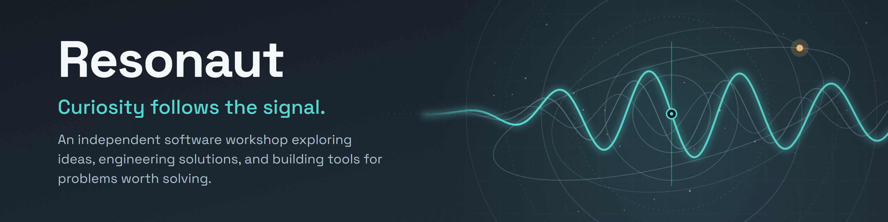

## About Resonaut

Resonaut is an independent software workshop built around a simple idea: useful software starts with asking better questions and refusing to stop at the obvious answer.

We explore problems, experiment with different approaches, and turn promising ideas into practical software.

Our interests span software engineering, audio and media processing, language technologies, and tools that make complicated things easier to work with.

We care less about following trends and more about understanding problems deeply enough to solve them properly.

## What we're interested in

- **Media & Signal Processing** - Exploring sound, speech, synchronization, and the challenges of making media work better.
- **Applied Machine Learning** - Finding practical ways to use intelligent systems without overlooking performance, reliability, or accessibility.
- **Software Engineering** - Building focused tools, exploring unconventional solutions, and improving existing software.
- **Developer Tools** - Making everyday technical problems less complicated.

## Projects

<table>
<tr>
<td valign="top">

&nbsp;&nbsp;<a href="https://github.com/resonaut/SubSync-Echo"><b>SubSync Echo</b></a> 
&nbsp;&nbsp;C++ · Python · Whisper
 

Syncs subtitles to the speech in a video, in almost any language, fully offline. It listens to the dialogue with Whisper, translates when the subtitles and the audio are in different languages, and moves every line to the moment it's spoken. Runs on Windows and Linux, no graphics card needed.

Continues <a href="https://github.com/sc0ty/subsync">SubSync</a> by Mike Szymaniak, which is no longer maintained.
</td>
</tr>
</table>

---

## How we build

Our approach is straightforward:

- Understand the problem before choosing the tools.
- Prefer the smallest reliable solution over unnecessary complexity.
- Test against real-world conditions, not just ideal examples.
- Treat performance and accessibility as engineering concerns.
- Be honest about limitations and prioritize useful results over impressive claims.

We believe good engineering is not about making things complicated. It is about making complicated problems understandable and manageable.

## Open source & collaboration

We believe useful software should be shared.

Issues, thoughtful suggestions, and contributions are welcome. Whether you have found an awkward edge case, an alternative approach, or an idea worth exploring, we'd like to hear about it.

The best place to start is the repository you're interested in.

---

Built with curiosity. Driven by problems. Refined through engineering.

